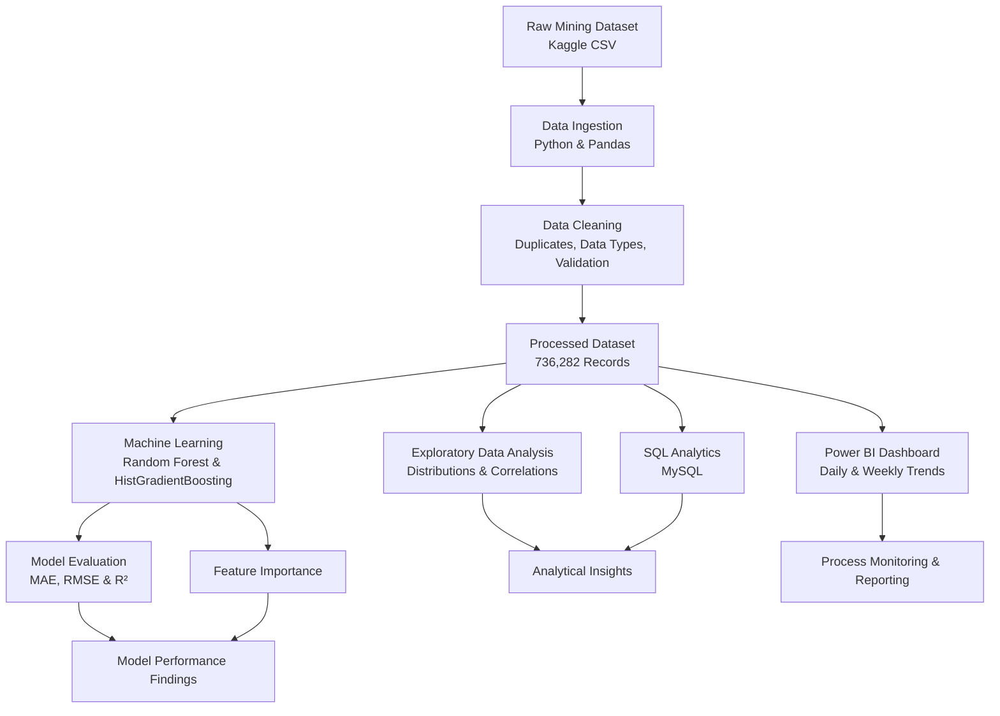
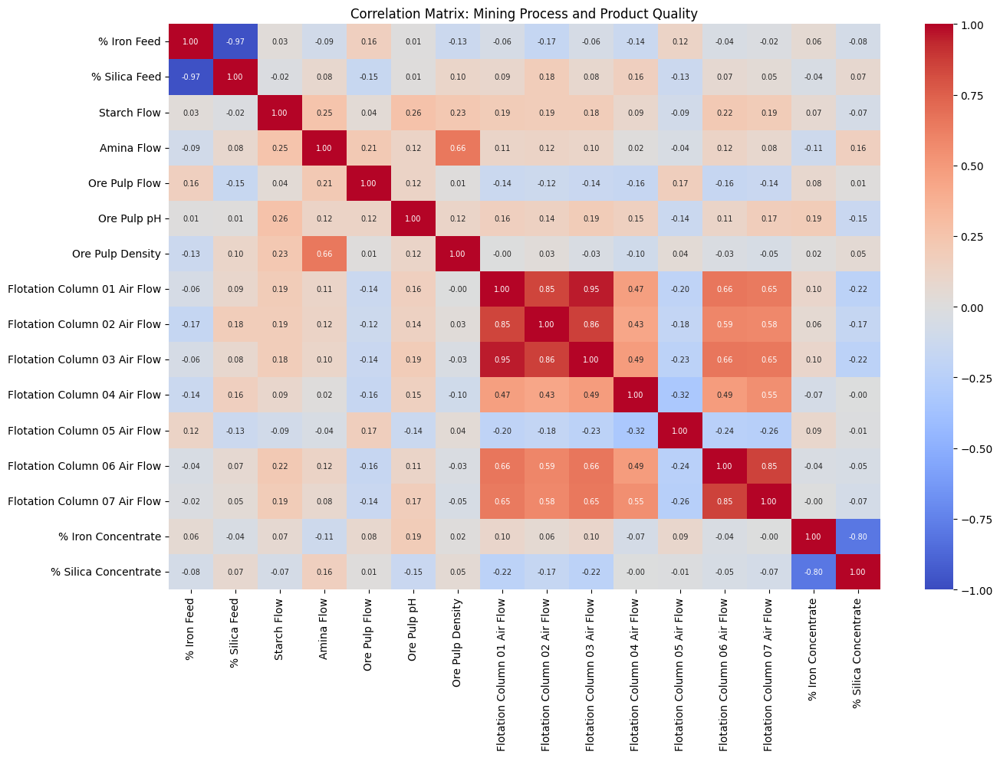
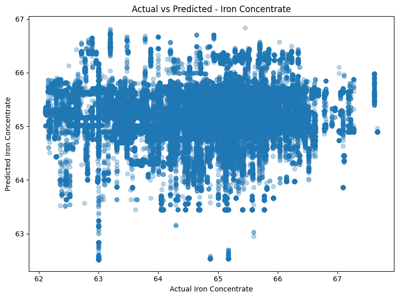
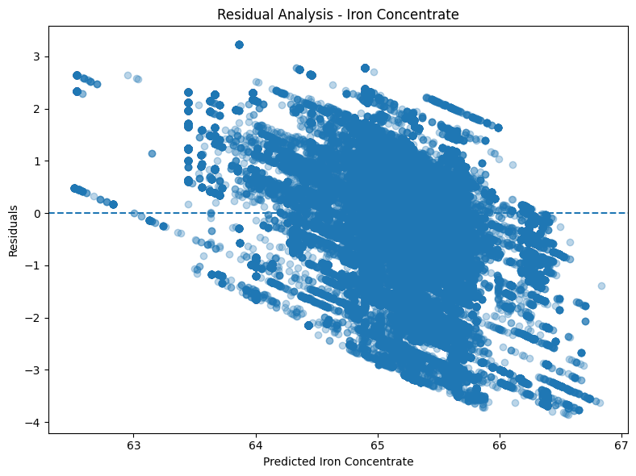
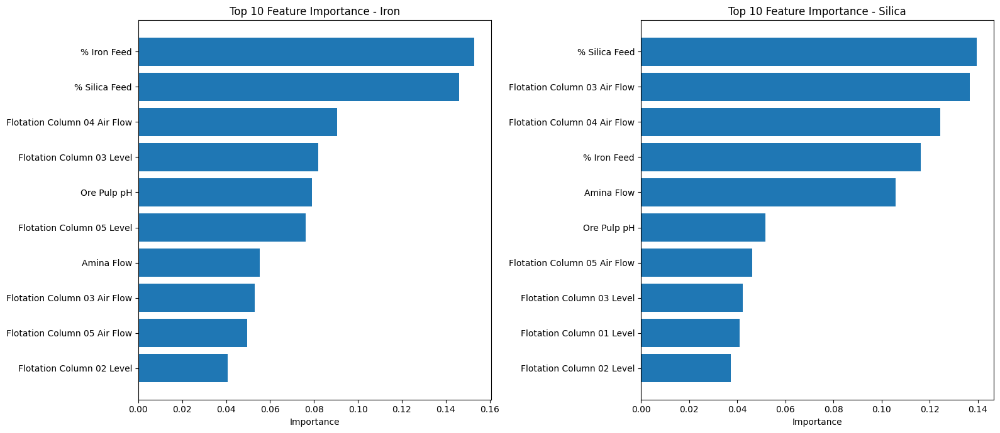
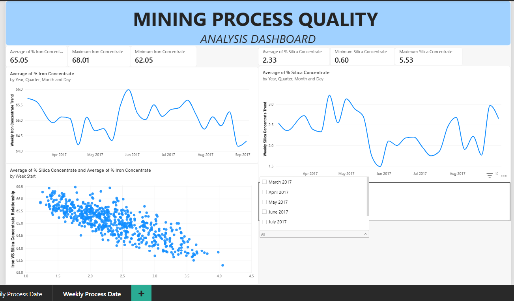
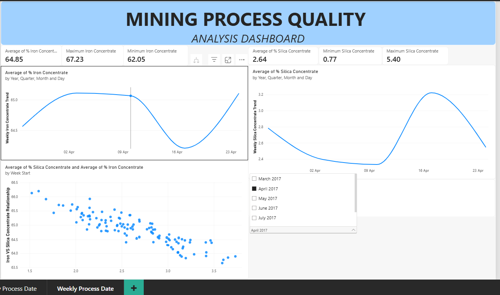

# Mining Process Quality Prediction

## Project Overview

This project analyzes iron ore flotation process data to explore operational patterns and develop machine learning models for predicting iron concentrate and silica concentrate quality.

The project combines data cleaning, exploratory data analysis (EDA), SQL analysis, machine learning, and Power BI visualization to demonstrate an end-to-end data science workflow.

## Project Highlights

| Area | Highlights | Tools |
|---|---|---|
| Data Cleaning | Processed 737,453 records, removed 1,171 duplicates, and prepared 736,282 clean records with 24 columns. | Python, Pandas |
| Exploratory Data Analysis | Analyzed data distributions, feature correlations, concentrate quality, and process trends over time. | Pandas, Matplotlib, Seaborn |
| SQL Analytics | Prepared a workflow for querying and analyzing mining process data. | MySQL |
| Machine Learning | Developed regression models to predict iron and silica concentrate quality. | Scikit-learn |
| Model Evaluation | Compared Random Forest and HistGradientBoosting against a mean baseline using MAE, RMSE, and R². | Python, Scikit-learn |
| Feature Importance | Identified influential model inputs, including iron feed, silica feed, and flotation column air flow. | Scikit-learn, Pandas |
| Power BI Dashboard | Built daily and weekly dashboards to monitor concentrate quality and operational indicators. | Power BI |
| Documentation & Reproducibility | Organized project documentation, dependencies, visualizations, and downloadable dashboard access. | GitHub, Markdown |

### Key Machine Learning Results

| Target | Model | MAE | RMSE | R² |
|---|---|---:|---:|---:|
| Iron Concentrate | HistGradientBoosting | 0.8958 | 1.1860 | -0.1472 |
| Silica Concentrate | HistGradientBoosting | 0.8841 | 1.1103 | 0.0613 |

### Key Findings

- HistGradientBoosting performed better than the mean baseline for silica concentrate prediction across the reported MAE, RMSE, and R² metrics.
- For iron concentrate, the mean baseline performed better than HistGradientBoosting, indicating that further feature engineering and model improvement are needed.
- The project combines data preparation, exploratory analysis, machine learning evaluation, and Power BI visualization in an industrial mining context.

## Business Problem

In mineral processing, concentrate quality is an important indicator of process performance. Understanding operational measurements and their relationship with concentrate quality can help analysts investigate process behavior and identify opportunities for further optimization.

This project explores whether historical process measurements can predict:

- **Iron Concentrate (%)**
- **Silica Concentrate (%)**

The models are experimental and are not intended for direct operational deployment.

## Dataset

- **Source:** Kaggle — Quality Prediction in a Mining Process : https://www.kaggle.com/code/korrapatyairit/ml-regression-quality-prediction-in-a-mining-proc/input
- **Time period:** March–September 2017
- **Cleaned records:** 736,282
- **Original columns:** 24
- **Model inputs:** 21 numerical process features
- **Prediction targets:** Iron Concentrate and Silica Concentrate

The dataset contains operational measurements from an iron ore flotation process.


## End-to-End Architecture

The project follows an end-to-end data analytics workflow, transforming raw mining process data into cleaned datasets, analytical insights, machine learning evaluations, and interactive business intelligence dashboards.




## Project Workflow

Architecture Flow

1. Data Source: Obtain the mining process dataset from Kaggle.

2. Data Ingestion: Load the original CSV using Python and Pandas.

3. Data Preparation: Remove duplicate records, validate data types, and prepare the cleaned dataset.

4. Analytics: Explore data patterns and perform SQL-based analysis.

5. Machine Learning: Train regression models to estimate iron and silica concentrate quality.

6. Model Evaluation: Compare model predictions against actual values and a mean baseline.

7. Business Intelligence: Visualize process KPIs and daily or weekly trends in Power BI.

8. Reporting: Document findings, model limitations, and dashboard outputs in GitHub.

## Project Implementation Layers

| Layer | Implementation | Technology | Output |
|---|---|---|---|
| 1. Data Source Layer | Obtained the iron ore flotation process dataset. | Kaggle, CSV | Raw mining dataset |
| 2. Data Ingestion Layer | Loaded the dataset and interpreted numeric values and dates correctly. | Python, Pandas | Structured DataFrame |
| 3. Data Cleaning Layer | Removed 1,171 duplicate records and validated data quality. | Pandas, NumPy | Cleaned dataset with 736,282 rows and 24 columns |
| 4. Data Storage Layer | Organized processed data and prepared a MySQL database table. | CSV, MySQL | Reusable analytical dataset |
| 5. Exploratory Analytics Layer | Examined descriptive statistics, distributions, correlations, and temporal trends. | Pandas, Matplotlib, Seaborn | EDA visualizations and findings |
| 6. SQL Analytics Layer | Prepared the database for querying mining process measurements. | MySQL | SQL-based analytical queries |
| 7. Machine Learning Layer | Trained regression models for iron and silica concentrate targets. | Scikit-learn | Random Forest and HistGradientBoosting models |
| 8. Model Evaluation Layer | Evaluated predictions against actual measurements and a mean baseline. | MAE, RMSE, R² | Model comparison and performance findings |
| 9. Feature Analysis Layer | Ranked input variables according to model feature importance. | Scikit-learn, Pandas | Feature importance tables and charts |
| 10. Visualization Layer | Built daily and weekly process monitoring dashboards. | Power BI | KPI cards, trend charts, and scatter plots |
| 11. Documentation Layer | Documented the workflow, dependencies, results, and dashboard access. | GitHub, Markdown | Reproducible project documentation |

### Implementation Status

- **Implemented:** Data cleaning, exploratory data analysis, regression model training, model evaluation, feature importance, and Power BI dashboard development.
- **Prepared / verify completion:** SQL analysis and database queries.
- **Documentation and sharing:** GitHub README, Python dependencies, visualizations, and Power BI dashboard download link.

The project is designed as an analytical workflow rather than a production deployment. Automated data pipelines, scheduled model retraining, and live model serving are potential future enhancements.


## Machine Learning Models

The project evaluates the following approaches:

- Mean-based baseline
- Random Forest Regressor
- HistGradientBoosting Regressor

The dataset is split chronologically, using the earlier 80% of records for training and the later 20% for testing.

### Evaluation Metrics

- **MAE:** Mean Absolute Error
- **RMSE:** Root Mean Squared Error
- **R²:** Coefficient of Determination

Lower MAE and RMSE values are preferable. Higher R² values generally indicate better predictive performance.

## Preliminary Results

## Exploratory Data Analysis

### Correlation Heatmap


## Machine Learning Results




### Feature Importance



The HistGradientBoosting model achieved the following results on the test set:

| Target | MAE | RMSE | R² |
|---|---:|---:|---:|
| Iron Concentrate | 0.8958 | 1.1860 | -0.1472 |
| Silica Concentrate | 0.8841 | 1.1103 | 0.0613 |

The current Iron model did not outperform the test-set mean benchmark according to R². The Silica model achieved a small positive R², indicating limited predictive performance.

These results show that further model development and validation are required. The models should not yet be used for operational decision-making.

## Power BI Dashboard

### Daily Process Analysis


### Weekly Process Analysis





## Power BI Dashboard

Download the interactive Power BI dashboard to explore the mining process quality analysis.

[**Download Mining Process Quality Dashboard (.pbix)**](https://drive.google.com/drive/folders/1YdG0BIxwsitlt5_Jer5VKASA_fI-zQMg?usp=drive_link) 

*Requires Power BI Desktop to open and interact with the dashboard.*

## Tools and Technologies

- Python
- Pandas and NumPy
- Matplotlib and Seaborn
- Scikit-learn
- SQL / MySQL
- Power BI
- Google Colab
- Git and GitHub

## Repository Structure

```text
Mining-Process-Quality-Prediction/
├── 01_data_cleaning.py
├── 02_exploratory_data_analysis.py
├── 03_machine_learning.py
├── data/
├── models/
├── powerbi/
├── sql/
└── README.md
```

The actual repository structure may differ depending on the final organization of the files.

## Limitations and Future Improvements

- Improve predictive performance through feature engineering and hyperparameter tuning.
- Investigate prediction errors across different operating periods.
- Compare additional regression algorithms.
- Explore time-aware validation and potential process changes.
- Extend the Power BI dashboard with validated operational insights.

## Conclusion

This project demonstrates an end-to-end data science workflow, from data preparation and exploratory analysis to SQL, dashboard development, and regression modeling.

Although the current models show limited predictive performance, the project establishes a reproducible foundation for further investigation into mining process quality.

## Author

Data Science Portfolio Project
